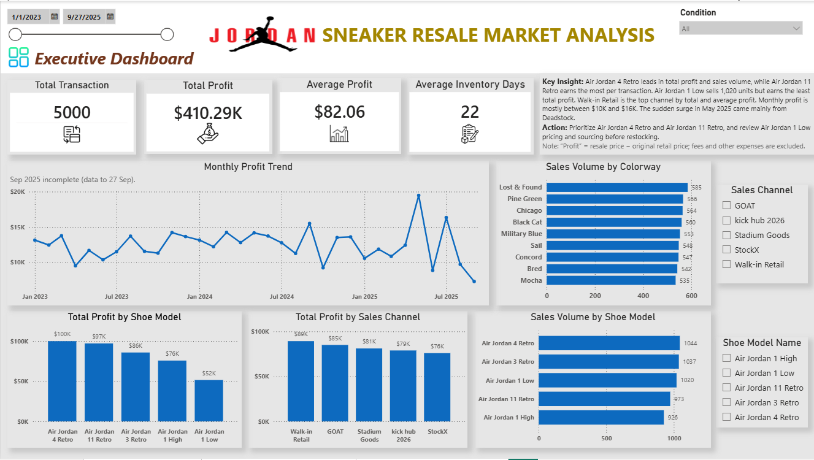
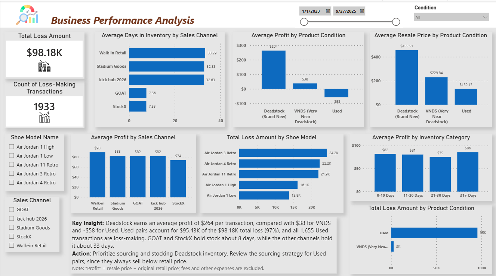
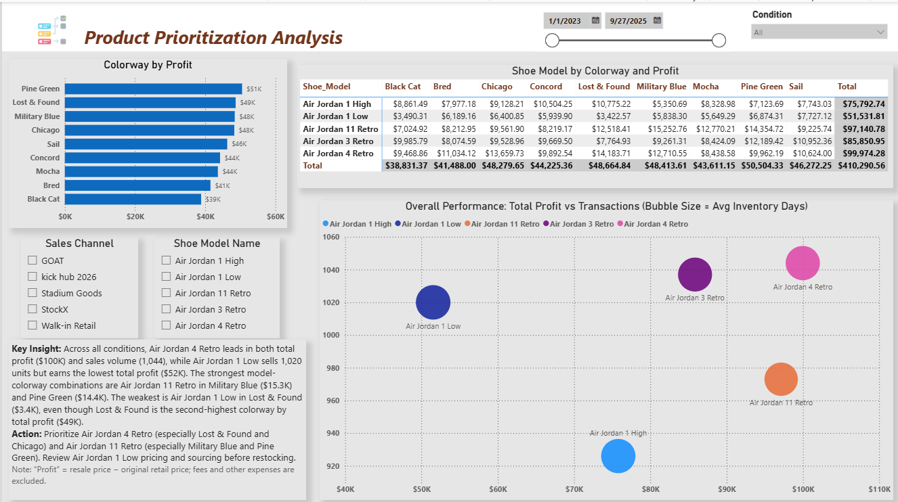

# Jordan Sneaker Market Analysis | SQL Server & Power BI

## Project Summary

This project demonstrates end-to-end data analysis using SQL Server and Power BI. It covers data validation, exploratory data analysis (EDA), business analysis, and interactive dashboard development to generate actionable business insights for sneaker resale market performance.

---

## Business Problem

Businesses operating in the sneaker resale market must balance customer demand, profitability, inventory turnover, and sales channel performance when making product selection and inventory investment decisions.

Without data-driven analysis, it becomes difficult to identify which products deserve additional investment, which sales channels generate the greatest value, or how operational factors such as inventory turnover and product condition influence profitability.

This project addresses these challenges by analyzing historical transaction data to answer key business questions and provide actionable recommendations for improving business performance.

The analysis focuses on answering questions such as:

- Which shoe models generate the highest sales and profit?
- Which colorways show the strongest demand based on transaction volume?
- Which sales channels perform best?
- How does product condition affect resale price and profitability?
- Which shoe models sell the fastest based on inventory turnover?
- Which shoe model–colorway combinations should the business prioritize based on overall performance?
- What drives loss-making transactions?
- Which sales channels turn over inventory the fastest?

---

## Dataset Overview

The dataset contains **5,000 Air Jordan sneaker market transactions**, providing detailed information about product characteristics, pricing, inventory, and sales performance.

### Dataset Features

| Column | Description |
|---------|-------------|
| Transaction_ID | Unique identifier for each transaction |
| Sale_Date | Date of sale |
| Shoe_Model | Jordan sneaker model |
| Colorway | Product colorway |
| Condition | Product condition |
| Retail_Price_USD | Original retail price |
| Resale_Price_USD | Selling price |
| Sales_Channel | Sales platform where the product was sold |
| Days_in_Inventory | Number of days before the product was sold |
| Profit_Margin_USD | Resale price minus original retail price; fees and other expenses are not deducted |

**Metric Interpretation:** Throughout this project, the terms “profit” and “loss” refer to the dataset's `Profit_Margin_USD` measure, calculated as resale price minus original retail price. The measure does not account for fees or other expenses, so it should not be interpreted as actual net profit or confirmed financial loss.

---

## Dataset Source

This project uses the **Air Jordan Sneaker Market and Resale Data (2023–2026)** dataset from Kaggle, containing 5,000 sneaker resale records with information on pricing, inventory, sales channels, and the difference between resale and retail prices.

**Source:** Kaggle – https://www.kaggle.com/datasets/abdullahmeo/air-jordan-sneaker-market-and-resale-data2023-2026

*Note:* While the dataset is titled "2023–2026" on Kaggle, the actual transaction records analyzed in this project span January 2023 to September 2025.

*Note:* This dataset was used for educational and portfolio purposes. Its records have not been independently verified as actual marketplace transactions, so findings should be interpreted as patterns within the dataset rather than confirmed real-world market outcomes. All SQL analysis, business insights, and Power BI dashboards were independently developed.

*Note:* This is an independent project and is not affiliated with or endorsed by Nike or Jordan Brand.

---

## Tools & Technologies

| Category | Technology |
|----------|------------|
| Database | SQL Server |
| Query Language | SQL |
| Data Visualization | Power BI |
| Version Control | Git & GitHub |

---

## Project Workflow

The project follows a structured business analytics workflow, progressing from understanding the business problem to delivering actionable insights through SQL analysis and interactive Power BI dashboards.

```text
Business Problem
        │
        ▼
Data Validation & Preparation
        │
        ▼
Exploratory Data Analysis (EDA)
        │
        ▼
Business Analysis
        │
        ▼
Business Insights & Recommendations
        │
        ▼
Interactive Power BI Dashboard
```
---

## Business Analysis

The SQL analysis was organized into seven business-focused domains to answer real business questions and support data-driven decision-making.

The analysis covers:

1. **Product Performance** – Evaluates sales performance across shoe models and colorways.
2. **Profitability** – Compares profit across products and analyzes loss-making records.
3. **Sales Channel Performance** – Compares profitability, sales volume, and inventory efficiency across different sales channels.
4. **Inventory Analysis** – Evaluates inventory turnover and its relationship with profitability.
5. **Product Condition Analysis** – Compares resale prices and profit across product conditions.
6. **Demand Analysis** – Identifies the most popular colorways and demand patterns across shoe models.
7. **Overall Product Performance** – Evaluates products by balancing sales volume, profitability, and inventory efficiency.

Each business domain was analyzed using SQL Server, followed by business insights and recommendations. The final findings were visualized through interactive Power BI dashboards.

---

## Power BI Dashboard

The SQL analysis was transformed into an interactive, 3-page Power BI dashboard to enable business stakeholders to monitor performance, compare products, and support data-driven decision-making. Each page includes a Key Insight and Action callout, translating the underlying data into clear business takeaways.

The dashboard tells a complete story across 3 pages: a high-level performance overview, a deeper operational and risk analysis, and a final view on which products to prioritize going forward.

### 1. Executive Dashboard

A high-level overview of overall business performance through key KPIs and summary visualizations.

Includes:
- Total Transactions, Total Profit, Average Profit, Average Inventory Days
- Monthly Profit Trend
- Sales Volume by Colorway
- Total Profit by Shoe Model
- Total Profit by Sales Channel
- Sales Volume by Shoe Model

**Key Insight:** Air Jordan 4 Retro leads in total profit and sales volume, while Air Jordan 11 Retro earns the most per transaction. Air Jordan 1 Low sells 1,020 units but earns the lowest total profit ($52K). Walk-in Retail is the top channel by total and average profit. Monthly profit is mostly between $10K and $16K. The sudden surge in May 2025 came mainly from Deadstock.
**Action:** Prioritize Air Jordan 4 Retro and Air Jordan 11 Retro, and review Air Jordan 1 Low pricing and sourcing before restocking.



---

### 2. Business Performance Analysis

Detailed operational insights into profitability, inventory turnover, and loss-making transactions.

Includes:
- Total Loss Amount, Count of Loss-Making Transactions
- Average Profit and Resale Price by Product Condition
- Average Profit by Inventory Category
- Average Profit by Sales Channel
- Average Days in Inventory by Sales Channel
- Total Loss Amount by Shoe Model
- Total Loss Amount by Product Condition

**Key Insight:** Deadstock earns an average profit of $264 per transaction, compared with $38 for VNDS and -$58 for Used. Used pairs account for $95.43K of the $98.18K total loss (97%), and all 1,655 Used transactions are loss-making. GOAT and StockX hold stock about 8 days, while the other channels hold it about 33 days.
**Action:** Prioritize sourcing and stocking Deadstock inventory. Review the sourcing strategy for Used pairs, since they always sell below retail price.



---
### 3. Product Prioritization Analysis

Combines resale price performance, transaction volume, and inventory efficiency to guide product prioritization decisions.

Includes:
- Profit by Colorway
- Shoe Model × Colorway Profit Matrix
- Overall Performance comparison (Profit vs. Sales Volume vs. Inventory Turnover) by Shoe Model

**Key Insight:** Across all conditions, Air Jordan 4 Retro leads in both total profit ($100K) and sales volume (1,044), while Air Jordan 1 Low sells 1,020 units but earns the lowest total profit ($52K). The strongest model-colorway combinations are Air Jordan 11 Retro in Military Blue ($15.3K) and Pine Green ($14.4K). The weakest is Air Jordan 1 Low in Lost & Found ($3.4K), even though Lost & Found is the second-highest colorway by total profit ($49K).
**Action:** Prioritize Air Jordan 4 Retro (especially Lost & Found and Chicago) and Air Jordan 11 Retro (especially Military Blue and Pine Green). Review Air Jordan 1 Low pricing and sourcing before restocking.



---
## Key Insights

- Across all conditions, Air Jordan 4 Retro leads in both total profit ($100K) and sales volume (1,044). Air Jordan 11 Retro earns the most per transaction.
- Air Jordan 1 Low sells 1,020 units but earns the lowest total profit ($52K).
- Deadstock earns an average profit of $264 per transaction, VNDS $38 and Used -$58.
- All 1,655 Used transactions are loss-making. Used accounts for about $95.43K (97%) of the $98.18K total loss, VNDS for about $2.75K (278 transactions), and Deadstock for none.
- GOAT and StockX hold stock about 8 days, while the other channels hold it about 33 days. Walk-in Retail has the highest average profit.
- The best balance of profit, volume and speed is Air Jordan 11 Retro in Military Blue (average profit $126, 121 units, 19 days).
- Monthly profit is mostly between $10K and $16K. The May 2025 surge came mainly from Deadstock.

---

## Business Recommendations

Based on the analysis, the following recommendations are proposed:

- Prioritize sourcing and stocking Deadstock inventory.
- Review the sourcing strategy for Used pairs, since all of them sold below retail price.
- Focus on Air Jordan 4 Retro (especially Lost & Found and Chicago) and Air Jordan 11 Retro (especially Military Blue and Pine Green).
- Review Air Jordan 1 Low pricing and sourcing before restocking.
- Use GOAT and StockX when fast turnover matters.

---

## Limitations

- September 2025 is incomplete (data ends 27 September 2025).
- "Profit" is measured against the retail price, not the purchase cost, so it is not real net profit.
- The data does not explain why profit surged in May 2025.
- The records were not verified as real marketplace transactions.

## Skills Demonstrated

- SQL
- Data Cleaning
- Data Validation
- Exploratory Data Analysis (EDA)
- Aggregate Functions
- CASE Expressions
- GROUP BY
- KPI Development
- Business Analytics
- Business Insight Generation
- Power BI Dashboard Design
- DAX (Measures, CALCULATE, DISTINCTCOUNT)
- Matrix & Scatter Chart Visualization
- Data Storytelling & Insight Communication

---

## Repository Structure

```text
Jordan-Sneaker-Market-Analysis/
│
├── Dataset/
│   └── jordan_market_dataset_2026.csv
│
├── SQL/
│   └── jordan_sneaker_market_analysis.sql
│
├── Power BI/
│   └── jordan_sneaker_market_analysis.pbix
│
├── Dashboard/
│   ├── Executive_Dashboard.png
│   ├── Business_Performance_Dashboard.png
│   └── Product_Prioritization_Analysis.png
│
└── README.md
```
---

## How to Run the Project

1. Import the dataset into SQL Server.
2. Execute the SQL script (`jordan_sneaker_market_analysis.sql`).
3. Open the Power BI dashboard (`jordan_sneaker_market_analysis.pbix`).
4. Refresh the Power BI data connection if prompted.
5. Explore the interactive dashboards using the available filters and slicers.

---

## Author

**Pranav P A**

- GitHub: https://github.com/Pranav175-bit
- LinkedIn: https://www.linkedin.com/in/pranav-p-a-8b3a57350/
 
---

## License

This project is licensed under the MIT License.
